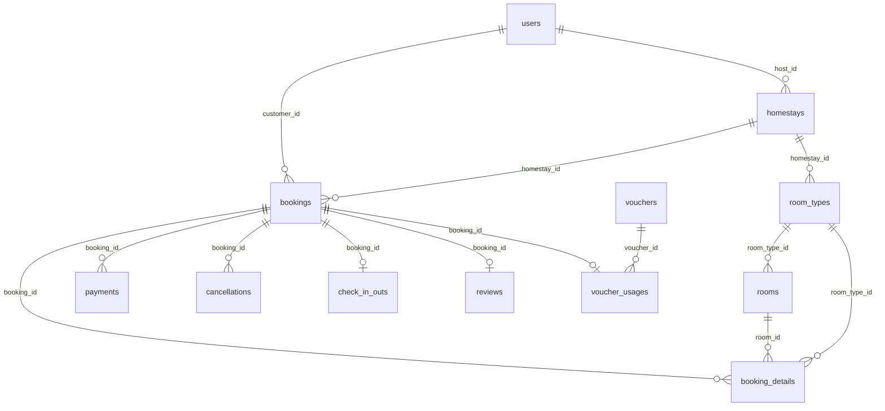

# Schema Neon hiện tại

Nguồn: truy vấn chỉ đọc metadata từ cơ sở dữ liệu `neondb`, schema `public`, ngày 20/09/2026.

**21 bảng · 34 khóa ngoại**

## Sơ đồ quan hệ chính

Các quan hệ còn lại, bao gồm tiện ích, hình ảnh, hóa đơn và đăng nhập ngoài, nằm trong danh sách khóa ngoại phía dưới.

## Bảng và cột

### `amenities`

| Cột | Kiểu PostgreSQL | Bắt buộc | Khóa | Mặc định |
|---|---|---|---|---|
| `amenity_id` | integer | Có | PK | `IDENTITY` |
| `name` | varchar(100) | Có |  | `—` |
| `icon_url` | varchar(500) | Không |  | `—` |
| `category` | varchar(50) | Có |  | `—` |
| `description` | varchar(255) | Không |  | `—` |

### `booking_details`

| Cột | Kiểu PostgreSQL | Bắt buộc | Khóa | Mặc định |
|---|---|---|---|---|
| `booking_detail_id` | bigint | Có | PK | `IDENTITY` |
| `booking_id` | bigint | Có | FK | `—` |
| `room_type_id` | bigint | Có | FK | `—` |
| `room_id` | bigint | Không | FK | `—` |
| `quantity` | integer | Có |  | `1` |
| `price_per_night` | numeric(18,2) | Có |  | `—` |
| `number_of_nights` | integer | Có |  | `—` |
| `extra_fee` | numeric(18,2) | Có |  | `0` |
| `line_total` | numeric(18,2) | Có |  | `—` |
| `guest_name` | varchar(100) | Không |  | `—` |
| `note` | varchar(500) | Không |  | `—` |

### `bookings`

| Cột | Kiểu PostgreSQL | Bắt buộc | Khóa | Mặc định |
|---|---|---|---|---|
| `booking_id` | bigint | Có | PK | `IDENTITY` |
| `booking_code` | varchar(30) | Có |  | `—` |
| `customer_id` | bigint | Có | FK | `—` |
| `homestay_id` | bigint | Có | FK | `—` |
| `check_in_date` | date | Có |  | `—` |
| `check_out_date` | date | Có |  | `—` |
| `adult_count` | integer | Có |  | `—` |
| `child_count` | integer | Có |  | `0` |
| `subtotal` | numeric(18,2) | Có |  | `—` |
| `discount_amount` | numeric(18,2) | Có |  | `0` |
| `service_fee` | numeric(18,2) | Có |  | `0` |
| `tax_amount` | numeric(18,2) | Có |  | `0` |
| `total_amount` | numeric(18,2) | Có |  | `—` |
| `status` | varchar(30) | Có |  | `'PendingPayment'::character varying` |
| `customer_note` | varchar(500) | Không |  | `—` |
| `created_at` | timestamptz | Có |  | `CURRENT_TIMESTAMP` |
| `updated_at` | timestamptz | Có |  | `CURRENT_TIMESTAMP` |

### `cancellations`

| Cột | Kiểu PostgreSQL | Bắt buộc | Khóa | Mặc định |
|---|---|---|---|---|
| `cancellation_id` | bigint | Có | PK | `IDENTITY` |
| `booking_id` | bigint | Có | FK | `—` |
| `cancelled_by` | bigint | Có | FK | `—` |
| `reason` | varchar(500) | Có |  | `—` |
| `cancelled_at` | timestamptz | Có |  | `CURRENT_TIMESTAMP` |
| `cancellation_fee` | numeric(18,2) | Có |  | `0` |
| `refund_amount` | numeric(18,2) | Có |  | `0` |
| `status` | varchar(30) | Có |  | `'Requested'::character varying` |
| `processed_by` | bigint | Không | FK | `—` |
| `processed_at` | timestamptz | Không |  | `—` |

### `check_in_outs`

| Cột | Kiểu PostgreSQL | Bắt buộc | Khóa | Mặc định |
|---|---|---|---|---|
| `check_in_out_id` | bigint | Có | PK | `IDENTITY` |
| `booking_id` | bigint | Có | FK | `—` |
| `checked_in_by` | bigint | Không | FK | `—` |
| `actual_check_in_at` | timestamptz | Không |  | `—` |
| `checked_out_by` | bigint | Không | FK | `—` |
| `actual_check_out_at` | timestamptz | Không |  | `—` |
| `guest_identity_number` | varchar(30) | Không |  | `—` |
| `deposit_amount` | numeric(18,2) | Có |  | `0` |
| `additional_charge` | numeric(18,2) | Có |  | `0` |
| `note` | varchar(500) | Không |  | `—` |
| `status` | varchar(20) | Có |  | `'NotCheckedIn'::character varying` |

### `homestay_amenities`

| Cột | Kiểu PostgreSQL | Bắt buộc | Khóa | Mặc định |
|---|---|---|---|---|
| `homestay_amenity_id` | bigint | Có | PK | `IDENTITY` |
| `homestay_id` | bigint | Có | FK | `—` |
| `amenity_id` | integer | Có | FK | `—` |

### `homestay_images`

| Cột | Kiểu PostgreSQL | Bắt buộc | Khóa | Mặc định |
|---|---|---|---|---|
| `image_id` | bigint | Có | PK | `IDENTITY` |
| `homestay_id` | bigint | Có | FK | `—` |
| `image_url` | varchar(500) | Có |  | `—` |
| `caption` | varchar(255) | Không |  | `—` |
| `is_thumbnail` | boolean | Có |  | `false` |
| `sort_order` | integer | Có |  | `0` |
| `created_at` | timestamptz | Có |  | `CURRENT_TIMESTAMP` |

### `homestays`

| Cột | Kiểu PostgreSQL | Bắt buộc | Khóa | Mặc định |
|---|---|---|---|---|
| `homestay_id` | bigint | Có | PK | `IDENTITY` |
| `host_id` | bigint | Có | FK | `—` |
| `name` | varchar(200) | Có |  | `—` |
| `description` | text | Có |  | `—` |
| `address_line` | varchar(255) | Có |  | `—` |
| `ward` | varchar(100) | Có |  | `—` |
| `district` | varchar(100) | Có |  | `—` |
| `province` | varchar(100) | Có |  | `—` |
| `latitude` | numeric(10,7) | Không |  | `—` |
| `longitude` | numeric(10,7) | Không |  | `—` |
| `check_in_time` | time | Có |  | `—` |
| `check_out_time` | time | Có |  | `—` |
| `status` | varchar(30) | Có |  | `'Draft'::character varying` |
| `created_at` | timestamptz | Có |  | `CURRENT_TIMESTAMP` |
| `updated_at` | timestamptz | Có |  | `CURRENT_TIMESTAMP` |
| `rejection_reason` | varchar(500) | Không |  | `—` |
| `reviewed_by` | bigint | Không | FK | `—` |
| `reviewed_at` | timestamptz | Không |  | `—` |

### `invoices`

| Cột | Kiểu PostgreSQL | Bắt buộc | Khóa | Mặc định |
|---|---|---|---|---|
| `invoice_id` | bigint | Có | PK | `IDENTITY` |
| `invoice_number` | varchar(30) | Có |  | `—` |
| `booking_id` | bigint | Có | FK | `—` |
| `customer_name` | varchar(100) | Có |  | `—` |
| `customer_email` | varchar(255) | Không |  | `—` |
| `customer_address` | varchar(255) | Không |  | `—` |
| `tax_code` | varchar(30) | Không |  | `—` |
| `subtotal` | numeric(18,2) | Có |  | `—` |
| `tax_amount` | numeric(18,2) | Có |  | `—` |
| `total_amount` | numeric(18,2) | Có |  | `—` |
| `issued_at` | timestamptz | Có |  | `CURRENT_TIMESTAMP` |
| `status` | varchar(20) | Có |  | `'Issued'::character varying` |
| `invoice_file_url` | varchar(500) | Không |  | `—` |

### `payments`

| Cột | Kiểu PostgreSQL | Bắt buộc | Khóa | Mặc định |
|---|---|---|---|---|
| `payment_id` | bigint | Có | PK | `IDENTITY` |
| `booking_id` | bigint | Có | FK | `—` |
| `transaction_code` | varchar(100) | Có |  | `—` |
| `payment_method` | varchar(30) | Có |  | `—` |
| `transaction_type` | varchar(20) | Có |  | `—` |
| `amount` | numeric(18,2) | Có |  | `—` |
| `status` | varchar(30) | Có |  | `'Pending'::character varying` |
| `paid_at` | timestamptz | Không |  | `—` |
| `gateway_response` | text | Không |  | `—` |
| `created_at` | timestamptz | Có |  | `CURRENT_TIMESTAMP` |
| `updated_at` | timestamptz | Có |  | `CURRENT_TIMESTAMP` |

### `reviews`

| Cột | Kiểu PostgreSQL | Bắt buộc | Khóa | Mặc định |
|---|---|---|---|---|
| `review_id` | bigint | Có | PK | `IDENTITY` |
| `booking_id` | bigint | Có | FK | `—` |
| `customer_id` | bigint | Có | FK | `—` |
| `homestay_id` | bigint | Có | FK | `—` |
| `rating` | integer | Có |  | `—` |
| `comment` | varchar(2000) | Không |  | `—` |
| `host_reply` | varchar(2000) | Không |  | `—` |
| `host_replied_at` | timestamptz | Không |  | `—` |
| `status` | varchar(20) | Có |  | `'Visible'::character varying` |
| `created_at` | timestamptz | Có |  | `CURRENT_TIMESTAMP` |
| `updated_at` | timestamptz | Có |  | `CURRENT_TIMESTAMP` |

### `room_images`

| Cột | Kiểu PostgreSQL | Bắt buộc | Khóa | Mặc định |
|---|---|---|---|---|
| `image_id` | bigint | Có | PK | `IDENTITY` |
| `room_id` | bigint | Có | FK | `—` |
| `image_url` | varchar(500) | Có |  | `—` |
| `caption` | varchar(255) | Không |  | `—` |
| `is_thumbnail` | boolean | Có |  | `false` |
| `sort_order` | integer | Có |  | `0` |
| `created_at` | timestamptz | Có |  | `CURRENT_TIMESTAMP` |

### `room_price_periods`

| Cột | Kiểu PostgreSQL | Bắt buộc | Khóa | Mặc định |
|---|---|---|---|---|
| `price_period_id` | bigint | Có | PK | `IDENTITY` |
| `room_type_id` | bigint | Có | FK | `—` |
| `name` | varchar(100) | Có |  | `—` |
| `start_date` | date | Có |  | `—` |
| `end_date` | date | Có |  | `—` |
| `price_per_night` | numeric(18,2) | Có |  | `—` |
| `created_at` | timestamptz | Có |  | `CURRENT_TIMESTAMP` |

### `room_type_amenities`

| Cột | Kiểu PostgreSQL | Bắt buộc | Khóa | Mặc định |
|---|---|---|---|---|
| `room_type_amenity_id` | bigint | Có | PK | `IDENTITY` |
| `room_type_id` | bigint | Có | FK | `—` |
| `amenity_id` | integer | Có | FK | `—` |

### `room_type_images`

| Cột | Kiểu PostgreSQL | Bắt buộc | Khóa | Mặc định |
|---|---|---|---|---|
| `image_id` | bigint | Có | PK | `IDENTITY` |
| `room_type_id` | bigint | Có | FK | `—` |
| `image_url` | varchar(500) | Có |  | `—` |
| `caption` | varchar(255) | Không |  | `—` |
| `is_thumbnail` | boolean | Có |  | `false` |
| `sort_order` | integer | Có |  | `0` |
| `created_at` | timestamptz | Có |  | `CURRENT_TIMESTAMP` |

### `room_types`

| Cột | Kiểu PostgreSQL | Bắt buộc | Khóa | Mặc định |
|---|---|---|---|---|
| `room_type_id` | bigint | Có | PK | `IDENTITY` |
| `homestay_id` | bigint | Có | FK | `—` |
| `name` | varchar(150) | Có |  | `—` |
| `description` | text | Có |  | `—` |
| `base_price` | numeric(18,2) | Có |  | `—` |
| `max_adults` | integer | Có |  | `—` |
| `max_children` | integer | Có |  | `—` |
| `bed_type` | varchar(100) | Có |  | `—` |
| `room_size` | numeric(8,2) | Không |  | `—` |
| `status` | varchar(20) | Có |  | `'Active'::character varying` |
| `created_at` | timestamptz | Có |  | `CURRENT_TIMESTAMP` |
| `updated_at` | timestamptz | Có |  | `CURRENT_TIMESTAMP` |
| `base_capacity` | integer | Có |  | `2` |
| `max_capacity` | integer | Có |  | `2` |
| `extra_guest_allowed` | boolean | Có |  | `false` |
| `extra_guest_fee` | numeric(18,2) | Có |  | `0` |

### `rooms`

| Cột | Kiểu PostgreSQL | Bắt buộc | Khóa | Mặc định |
|---|---|---|---|---|
| `room_id` | bigint | Có | PK | `IDENTITY` |
| `room_type_id` | bigint | Có | FK | `—` |
| `room_number` | varchar(30) | Có |  | `—` |
| `floor_number` | integer | Không |  | `—` |
| `status` | varchar(30) | Có |  | `'Available'::character varying` |
| `note` | varchar(500) | Không |  | `—` |
| `created_at` | timestamptz | Có |  | `CURRENT_TIMESTAMP` |
| `updated_at` | timestamptz | Có |  | `CURRENT_TIMESTAMP` |

### `user_external_logins`

| Cột | Kiểu PostgreSQL | Bắt buộc | Khóa | Mặc định |
|---|---|---|---|---|
| `external_login_id` | bigint | Có | PK | `IDENTITY` |
| `user_id` | bigint | Có | FK | `—` |
| `provider` | varchar(20) | Có |  | `—` |
| `provider_subject` | varchar(255) | Có |  | `—` |
| `provider_email` | varchar(255) | Không |  | `—` |
| `email_verified` | boolean | Có |  | `false` |
| `created_at` | timestamptz | Có |  | `CURRENT_TIMESTAMP` |
| `last_login_at` | timestamptz | Có |  | `CURRENT_TIMESTAMP` |

### `users`

| Cột | Kiểu PostgreSQL | Bắt buộc | Khóa | Mặc định |
|---|---|---|---|---|
| `user_id` | bigint | Có | PK | `IDENTITY` |
| `full_name` | varchar(100) | Có |  | `—` |
| `email` | varchar(255) | Có |  | `—` |
| `phone_number` | varchar(20) | Không |  | `—` |
| `password_hash` | varchar(255) | Không |  | `—` |
| `role` | varchar(20) | Có |  | `'Customer'::character varying` |
| `avatar_url` | varchar(500) | Không |  | `—` |
| `date_of_birth` | date | Không |  | `—` |
| `gender` | varchar(20) | Không |  | `—` |
| `status` | varchar(20) | Có |  | `'Active'::character varying` |
| `created_at` | timestamptz | Có |  | `CURRENT_TIMESTAMP` |
| `updated_at` | timestamptz | Có |  | `CURRENT_TIMESTAMP` |
| `email_verification_code_hash` | varchar(64) | Không |  | `—` |
| `email_verification_expires_at` | timestamptz | Không |  | `—` |
| `email_verified_at` | timestamptz | Không |  | `—` |
| `failed_login_attempts` | integer | Có |  | `0` |
| `lockout_end` | timestamptz | Không |  | `—` |
| `email_verification_sent_at` | timestamptz | Không |  | `—` |
| `email_verification_failed_attempts` | integer | Có |  | `0` |
| `password_reset_code_hash` | varchar(64) | Không |  | `—` |
| `password_reset_expires_at` | timestamptz | Không |  | `—` |
| `password_reset_sent_at` | timestamptz | Không |  | `—` |
| `password_reset_failed_attempts` | integer | Có |  | `0` |
| `auth_version` | integer | Có |  | `0` |
| `cover_url` | varchar(500) | Không |  | `—` |
| `bio` | varchar(1000) | Không |  | `—` |
| `address` | varchar(255) | Không |  | `—` |

### `voucher_usages`

| Cột | Kiểu PostgreSQL | Bắt buộc | Khóa | Mặc định |
|---|---|---|---|---|
| `voucher_usage_id` | bigint | Có | PK | `IDENTITY` |
| `voucher_id` | bigint | Có | FK | `—` |
| `booking_id` | bigint | Có | FK | `—` |
| `customer_id` | bigint | Có | FK | `—` |
| `code_used` | varchar(50) | Có |  | `—` |
| `discount_amount` | numeric(18,2) | Có |  | `—` |
| `used_at` | timestamptz | Có |  | `CURRENT_TIMESTAMP` |

### `vouchers`

| Cột | Kiểu PostgreSQL | Bắt buộc | Khóa | Mặc định |
|---|---|---|---|---|
| `voucher_id` | bigint | Có | PK | `IDENTITY` |
| `code` | varchar(50) | Có |  | `—` |
| `name` | varchar(150) | Có |  | `—` |
| `description` | varchar(500) | Không |  | `—` |
| `discount_type` | varchar(20) | Có |  | `—` |
| `discount_value` | numeric(18,2) | Có |  | `—` |
| `maximum_discount` | numeric(18,2) | Không |  | `—` |
| `minimum_booking_amount` | numeric(18,2) | Có |  | `0` |
| `valid_from` | timestamptz | Có |  | `—` |
| `valid_until` | timestamptz | Có |  | `—` |
| `usage_limit` | integer | Không |  | `—` |
| `usage_limit_per_customer` | integer | Có |  | `1` |
| `homestay_id` | bigint | Không | FK | `—` |
| `status` | varchar(20) | Có |  | `'Active'::character varying` |
| `created_by` | bigint | Không | FK | `—` |
| `created_at` | timestamptz | Có |  | `CURRENT_TIMESTAMP` |
| `updated_at` | timestamptz | Có |  | `CURRENT_TIMESTAMP` |

## Khóa ngoại

- `booking_details`: `FOREIGN KEY (booking_id) REFERENCES bookings(booking_id) ON DELETE CASCADE`
- `booking_details`: `FOREIGN KEY (room_id) REFERENCES rooms(room_id)`
- `booking_details`: `FOREIGN KEY (room_type_id) REFERENCES room_types(room_type_id)`
- `bookings`: `FOREIGN KEY (customer_id) REFERENCES users(user_id)`
- `bookings`: `FOREIGN KEY (homestay_id) REFERENCES homestays(homestay_id)`
- `cancellations`: `FOREIGN KEY (booking_id) REFERENCES bookings(booking_id)`
- `cancellations`: `FOREIGN KEY (cancelled_by) REFERENCES users(user_id)`
- `cancellations`: `FOREIGN KEY (processed_by) REFERENCES users(user_id)`
- `check_in_outs`: `FOREIGN KEY (booking_id) REFERENCES bookings(booking_id) ON DELETE CASCADE`
- `check_in_outs`: `FOREIGN KEY (checked_in_by) REFERENCES users(user_id)`
- `check_in_outs`: `FOREIGN KEY (checked_out_by) REFERENCES users(user_id)`
- `homestay_amenities`: `FOREIGN KEY (amenity_id) REFERENCES amenities(amenity_id) ON DELETE CASCADE`
- `homestay_amenities`: `FOREIGN KEY (homestay_id) REFERENCES homestays(homestay_id) ON DELETE CASCADE`
- `homestay_images`: `FOREIGN KEY (homestay_id) REFERENCES homestays(homestay_id) ON DELETE CASCADE`
- `homestays`: `FOREIGN KEY (host_id) REFERENCES users(user_id)`
- `homestays`: `FOREIGN KEY (reviewed_by) REFERENCES users(user_id) ON DELETE SET NULL`
- `invoices`: `FOREIGN KEY (booking_id) REFERENCES bookings(booking_id)`
- `payments`: `FOREIGN KEY (booking_id) REFERENCES bookings(booking_id)`
- `reviews`: `FOREIGN KEY (booking_id) REFERENCES bookings(booking_id)`
- `reviews`: `FOREIGN KEY (customer_id) REFERENCES users(user_id)`
- `reviews`: `FOREIGN KEY (homestay_id) REFERENCES homestays(homestay_id)`
- `room_images`: `FOREIGN KEY (room_id) REFERENCES rooms(room_id) ON DELETE CASCADE`
- `room_price_periods`: `FOREIGN KEY (room_type_id) REFERENCES room_types(room_type_id) ON DELETE CASCADE`
- `room_type_amenities`: `FOREIGN KEY (amenity_id) REFERENCES amenities(amenity_id) ON DELETE CASCADE`
- `room_type_amenities`: `FOREIGN KEY (room_type_id) REFERENCES room_types(room_type_id) ON DELETE CASCADE`
- `room_type_images`: `FOREIGN KEY (room_type_id) REFERENCES room_types(room_type_id) ON DELETE CASCADE`
- `room_types`: `FOREIGN KEY (homestay_id) REFERENCES homestays(homestay_id) ON DELETE CASCADE`
- `rooms`: `FOREIGN KEY (room_type_id) REFERENCES room_types(room_type_id) ON DELETE CASCADE`
- `user_external_logins`: `FOREIGN KEY (user_id) REFERENCES users(user_id) ON DELETE CASCADE`
- `voucher_usages`: `FOREIGN KEY (booking_id) REFERENCES bookings(booking_id) ON DELETE CASCADE`
- `voucher_usages`: `FOREIGN KEY (customer_id) REFERENCES users(user_id)`
- `voucher_usages`: `FOREIGN KEY (voucher_id) REFERENCES vouchers(voucher_id)`
- `vouchers`: `FOREIGN KEY (created_by) REFERENCES users(user_id)`
- `vouchers`: `FOREIGN KEY (homestay_id) REFERENCES homestays(homestay_id) ON DELETE CASCADE`

## Ràng buộc duy nhất

- `amenities`: `UNIQUE (name)`
- `bookings`: `UNIQUE (booking_code)`
- `check_in_outs`: `UNIQUE (booking_id)`
- `homestay_amenities`: `UNIQUE (homestay_id, amenity_id)`
- `invoices`: `UNIQUE (invoice_number)`
- `payments`: `UNIQUE (transaction_code)`
- `reviews`: `UNIQUE (booking_id)`
- `room_type_amenities`: `UNIQUE (room_type_id, amenity_id)`
- `room_types`: `UNIQUE (homestay_id, name)`
- `rooms`: `UNIQUE (room_type_id, room_number)`
- `user_external_logins`: `UNIQUE (provider, provider_subject)`
- `user_external_logins`: `UNIQUE (user_id, provider)`
- `users`: `UNIQUE (email)`
- `users`: `UNIQUE (phone_number)`
- `voucher_usages`: `UNIQUE (booking_id)`
- `vouchers`: `UNIQUE (code)`
