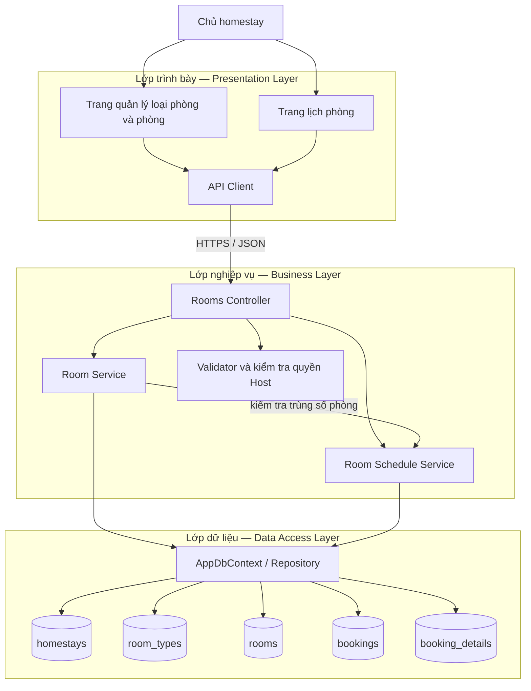
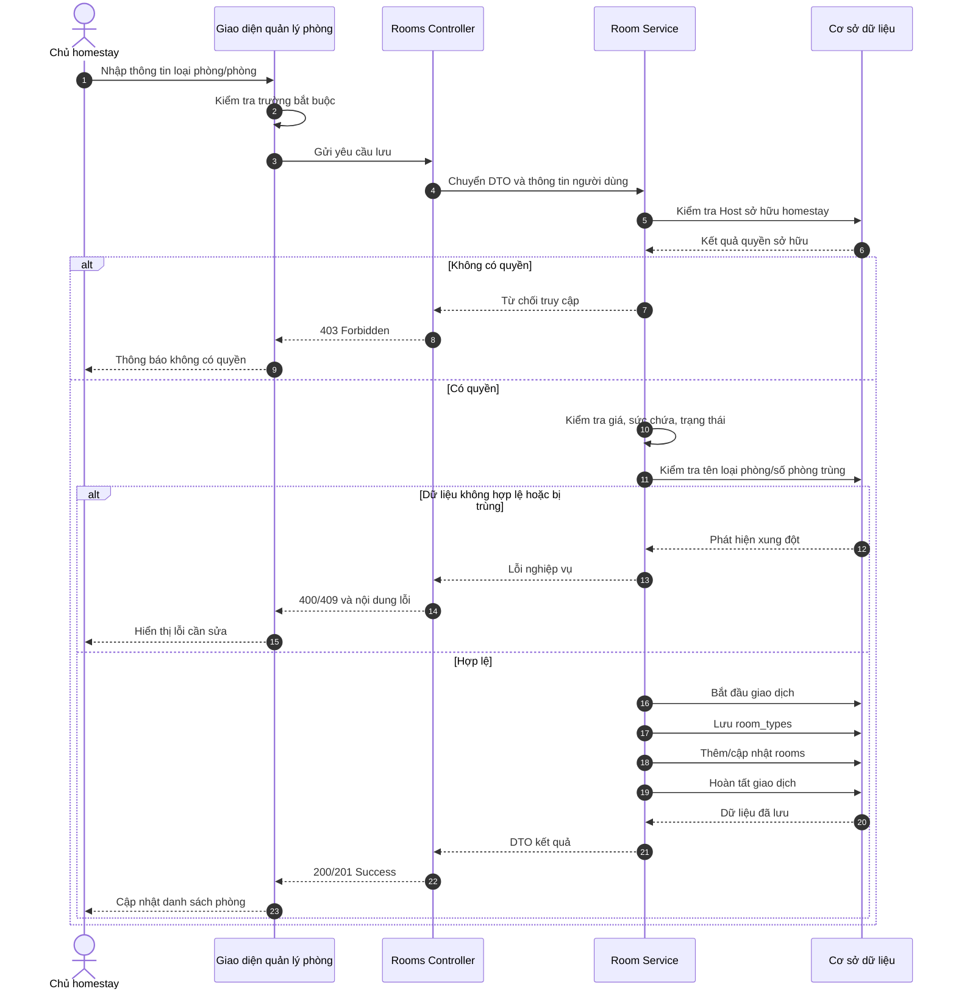
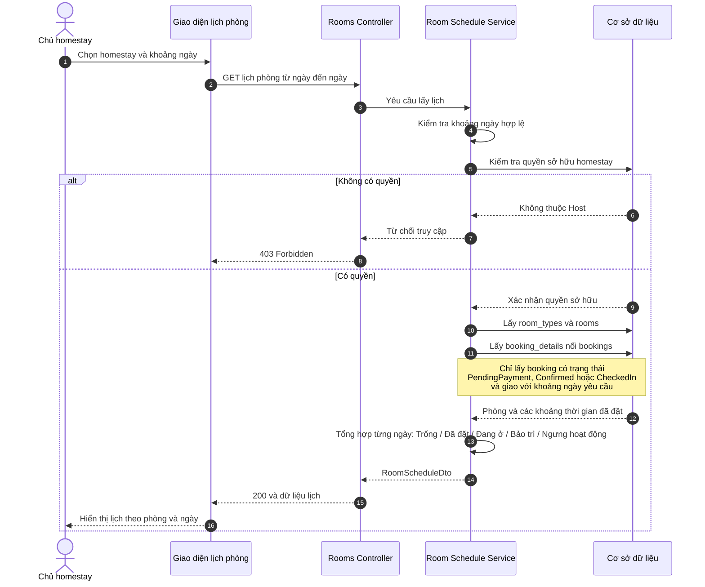
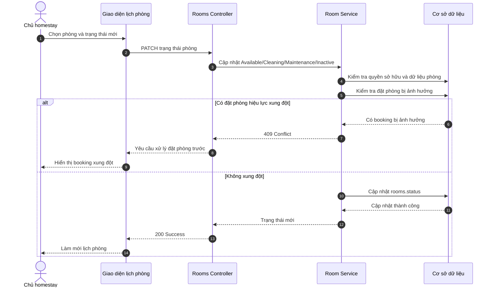

# Sơ đồ quản lý cấu trúc phòng và lịch phòng

## 1. Sơ đồ kiến trúc 3 lớp

### Trách nhiệm từng lớp

- **Presentation Layer:** nhận thao tác của Host, hiển thị loại phòng, phòng vật lý và lịch theo ngày.
- **Business Layer:** xác thực dữ liệu, kiểm tra quyền sở hữu homestay, kiểm tra trùng số phòng và xác định trạng thái phòng theo lịch đặt.
- **Data Access Layer:** đọc/ghi `room_types`, `rooms`; kết hợp `bookings` và `booking_details` để tạo lịch phòng.

## 2. Sequence quản lý cấu trúc phòng

Luồng dưới đây áp dụng cho thao tác thêm hoặc cập nhật loại phòng và các phòng vật lý thuộc loại phòng đó.

## 3. Sequence xem lịch phòng

Lịch được tổng hợp từ phòng vật lý, trạng thái phòng và các đặt phòng đang có hiệu lực; không cần lưu một bản lịch trùng lặp.

## 4. Sequence cập nhật trạng thái vận hành phòng

## Quy tắc nghiệp vụ chính

1. Một `homestay` có nhiều `room_types`; một `room_type` có nhiều `rooms`.
2. Tên loại phòng không được trùng trong cùng homestay.
3. Số phòng không được trùng trong cùng loại phòng.
4. Khoảng lưu trú dùng quy tắc nửa mở `[check_in_date, check_out_date)`: ngày trả phòng có thể là ngày nhận của lượt tiếp theo.
5. Một phòng không được có hai booking hiệu lực giao nhau.
6. Phòng `Maintenance` hoặc `Inactive` không được phân bổ cho booking mới.
7. Mọi thao tác sửa cấu trúc hoặc trạng thái phòng phải kiểm tra người dùng là Host sở hữu homestay.
